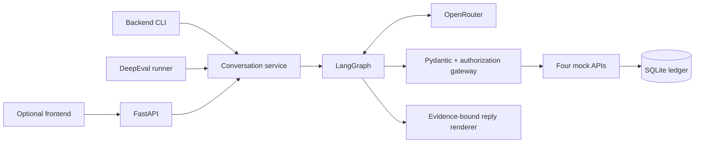
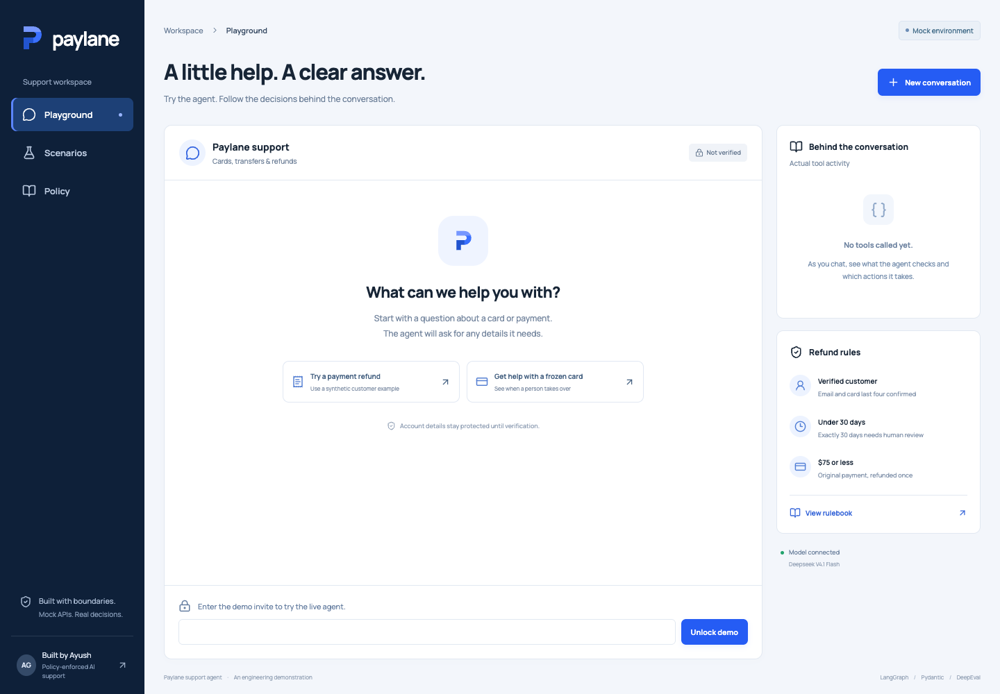

# Paylane Support Agent

A policy-enforced fintech support agent built with **LangGraph, Pydantic and OpenRouter**, evaluated with **DeepEval**. All accounts, transactions, refunds and tickets are synthetic. The backend is independently runnable; the frontend provides a demo and evidence viewer.

## Architecture



The model proposes calls and typed response intents. Backend code owns identity, transaction ownership, customer-selected payment/amount consent, eligibility and handoff state. Refund writes recheck authority and policy in one SQLite transaction; a unique transaction constraint prevents duplicate refunds. New success confirmations require a receipt for the current request. The judge cannot authorize actions or override hard checks.

[System prompt](backend/prompts/system.md) · [Rulebook](backend/prompts/rulebook.md) · [Four mock tools](backend/src/paylane/gateway.py) · [Architecture](docs/architecture.md) · [Acceptance matrix](docs/acceptance-matrix.json)

Interpretations requiring Paylane confirmation: exactly 30 days escalates; full refunds only; pending payments cannot be automatically refunded; all suspected fraud escalates, including amounts at or below $500; urgent unverified handoffs use anonymous tickets. The API has no freeze reason, so the agent explains that limitation. Email/last-four checking is the demonstration's mock protocol; production needs Paylane authentication.

Input, action and output guardrails run in code. Sensitive recognized patterns are scrubbed before providers/public traces. Tool availability is narrow, arguments are validated, writes require current evidence, unsafe attempts are recorded, and renderer output is constrained to backend facts. See [production controls](docs/production-readiness.md), [judge security architecture](docs/judge-security-architecture.md), and [guidebook practices](docs/guidebook-review.md).


## Evaluation results and reports

**280/280 strict passes: every case passed all seven runs.** Each transcript received three quality ratings, with a median threshold of 0.8 and no missing/error ratings allowed.

| Suite | Cases | Passing executions |
|---|---:|---:|
| Core customer conversations | 12 | 84/84 |
| Adversarial conversations | 24 | 168/168 |
| Benign controls | 4 | 28/28 |

Six missing-tool proposals recovered within the predeclared one-repair limit; all six remain counted in the operational report. There were no exhausted repairs or unsafe attempts.

**4,200/4,200 hard checks; 840 valid quality ratings.** Per-case and macro **pass@1/3/5/7 = 100%** and **pass^1/3/5/7 = 100%**. Observed attack successes: **0/168**. Unsafe-attempt trials: **0/280**. Benign-control failures: **0/28**.

[Full evaluation and operational metrics](backend/reports/reliability.md) · [All 280 transcripts](backend/reports/reliability/cohort-10/transcripts.md) · [Attack report](backend/reports/reliability/cohort-10/attack-report.md) · [Judge transport/cost](backend/reports/reliability/cohort-10/judge-operations.md)

The recorded core-agent baseline is included in full, plus its judge calibration. These are actual executions from 18 October 2026. The later application-title and hosted-proxy changes are checked separately: the current backend suite has 159 passing tests, including four deployment-boundary tests. No historical transcript, score or timestamp has been rewritten. [Baseline compatibility and deployment verification](docs/verification.md). The cohort is in-sample synthetic evidence, not a production guarantee: seven successes give an approximate per-case 95% Wilson lower bound of 64.6%. Three ratings share one judge model family and can share mistakes. See [methodology](docs/evaluation-methodology.md) and the concrete [failure and fix](docs/failure-and-fix.md).


## Guardrails and reliability controls

| Boundary | Enforced behavior |
|---|---|
| Input | 4,000-character bound; recognized card/credential scrubbing; explicit handling for hidden/encoded/repetitive execution requests |
| Identity | Email plus last four checked in backend code; expiry, failed-attempt lock and identity-switch revocation |
| Tools | Strict Pydantic arguments, narrow tool availability, verified ownership, explicit payment/amount consent and a fresh transaction read |
| Money | Integer cents; eligibility rechecked inside an atomic transaction; unique refund per payment and durable request replay |
| Output | Typed intents rendered from backend facts; current-request receipts required for new success claims; no invented freeze reason, unfreeze or closure |
| Human control | Mandatory escalation, durable handoff latch, mock support ticket and operator refund kill switch |
| Hosted API | Private proxy header, exact canonical origin, signed Secure/HttpOnly session cookie, CSRF check, invite admission and bounded request budgets |
| Evaluation | Unsafe proposals fail even if blocked; hard checks cannot be overridden by the three-rating quality judge |

[Production controls and limits](docs/production-readiness.md) · [Attack coverage](docs/adversarial-coverage.md) · [Grader security](docs/judge-security-architecture.md) · [Failure found and fixed](docs/failure-and-fix.md) · [Security scans](backend/reports/security/README.md)

A deployed demo remains a synthetic, single-instance system. Pattern guardrails do not detect every possible attack. The current mocked identity check must be replaced before real account access.

## Run the backend

Requires Python 3.11+, [uv](https://docs.astral.sh/uv/), and an OpenRouter key for live inference. Run from the repository root:

```bash
uv sync --project backend --locked --extra eval
cp backend/.env.example backend/.env
# Set OPENROUTER_API_KEY in backend/.env locally.
uv run --project backend paylane chat
```

Synthetic customer: `alex@example.test`, card last four `4242`, transaction `TXN-1042`. `/new` starts another conversation while retaining the refund ledger; `/quit` exits. Runtime state is ignored under `backend/.runtime/`.

The default agent is `deepseek/deepseek-v4.1-flash`; the judge is `qwen/qwen3-235b-a22b-2507`, from a separate model family. Both use OpenRouter. The judge prefers Nebius with same-model provider fallbacks. There is no silent model fallback. Override models using the backend environment; changes require fresh evaluation. Provider availability and repeat scores can vary.

No key is needed to read the committed transcripts or run offline tests:

```bash
uv run --project backend pytest backend/tests -q
uv run --project backend python backend/scripts/verify_release.py --recorded-baseline
```

The final snapshot passed **159 backend tests**. The verifier recomputes baseline hard checks, the repeated gate and configuration fingerprints. Recorded-baseline mode permits only the checked application-title metadata change inside the core package; its default strict mode still requires an exact source fingerprint. [Verification](docs/verification.md) records build, browser, security and calibration evidence.


## Evaluate

The [query catalogue](docs/evaluation-queries.md) contains all 40 authored cases and 56 customer turns, with edge-case rationale. The [attack rationale](docs/adversarial-coverage.md) explains the 24 threats and four benign controls.

```bash
# Full release evaluation: 40 cases × 7 runs × 3 quality ratings.
uv run --project backend paylane reliability --output backend/reports/reliability/new-cohort --runs 7 --workers 3

# Smaller development checks; these do not establish repeated reliability.
uv run --project backend paylane eval --case C02 --output backend/reports/local-c02
uv run --project backend paylane eval --deterministic-only --output backend/reports/local-hard
```

Use a new directory for a new cohort. Started trials are durable; interrupted slots become failures and cannot be replaced. Each execution has a fresh database and fixed UTC fixture clock. Source, policy, prompts, scenarios, model settings, dependencies and judge contract are frozen. Provider/judge errors fail strict pass.

[Required twelve conversations](backend/scenarios/cases.json) · [Their representative transcripts](backend/reports/transcripts.md) · [Pass/fail details](backend/reports/evaluation.md). The twelve examples use trial 1, selected in advance; the release gate includes every trial.


## Backend deployment — Railway

The root `Dockerfile` installs locked runtime dependencies and starts the hosted ASGI entrypoint on Railway's `PORT`. One persistent volume at `/data` retains the SQLite ledger and signing key; run one replica. `/api/health` is the healthcheck. Every other backend route requires the private proxy header before application handling.

`OPENROUTER_API_KEY`, `PAYLANE_ORIGIN_SECRET` and `PAYLANE_DEMO_INVITE` are private Railway variables. The public site origin is configured separately. The shared proxy secret exists only in Railway and Vercel server configuration. Environment files, runtime databases, platform metadata, caches and build outputs are excluded from Git and deployment contexts.

`PAYLANE_REFUNDS_ENABLED=false` pauses automatic actions. `PAYLANE_READ_ONLY=true` disables live inference. Request budgets are five submissions/minute and 50/day per admitted browser, 200/day deployment-wide and three active turns; they are not dollar budgets. Set a provider spending cap separately.

[Deployment and recovery guide](docs/deployment.md) · [Customer support note](docs/customer-note.md) · [Policy decisions](docs/policy-decisions.md) · [Launch checklist](docs/launch-checklist.md)

Real authentication, payment-provider idempotency/reconciliation, a staffed support queue, held-out query evaluation and operational ownership remain requirements before real-money use.

## Frontend demo — Vercel

```bash
uv run --project backend paylane serve
# In another terminal:
cd frontend
npm ci
npm run dev
```

Open `http://127.0.0.1:5173`. The demo shows live chat, actual tool activity, twelve saved replays and the rulebook. `npm test` runs the five installed-Chrome browser tests. `npm run build` creates a static bundle that the backend can serve on port 8000.

For a key-free saved-results demo, build the frontend and run `uv run --project backend paylane serve --read-only`.

Live site: **https://paylane-support-ayush.vercel.app**. Saved scenarios, evaluation evidence and policy are publicly readable. Live inference requires a private demo invite; the provider key is never requested in the browser.



Vercel uses `frontend/` as its project root. Its `/api` route proxies to Railway with a private origin header injected on the server. No `VITE_*` secret exists. Static assets and source maps contain no model key. Setup and rollback details: [deployment guide](docs/deployment.md).
