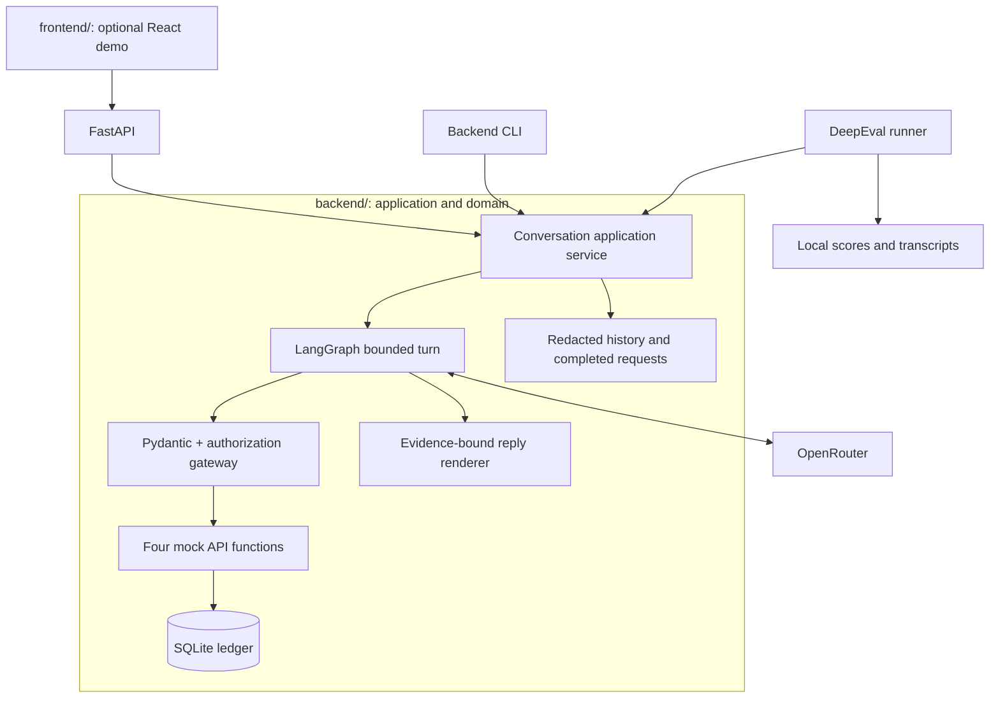
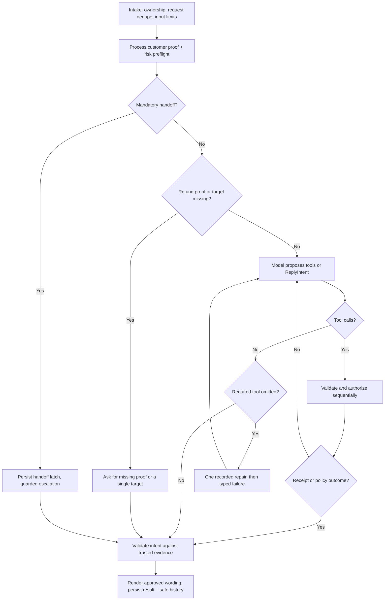

# Paylane support agent: implemented architecture

October 18, 2026. This document describes the implementation; the original planning document is retained under `docs/superpowers/plans/`. The backend is independently runnable. The separate design A frontend is an optional demonstration client. Repeated release evidence is reported separately; architecture alone is not proof that the release gate passed.

## Scope and components

LangGraph orchestrates a bounded support turn; Pydantic validates tool arguments and reply intents; OpenRouter provides inference; DeepEval evaluates real captured conversations; SQLite persists mock domain state. FastAPI is a thin transport over the same service used by CLI and evals. There is no second agent framework, vector database, broker or real payment integration.



The package deliberately uses a small set of readable modules rather than the initially proposed nested subpackages:

| Module | Responsibility |
|---|---|
| `domain.py` | Pydantic domain types, decimal-to-cents conversion, pure refund decision |
| `store.py` | SQLite repositories, expiring identity, atomic effects and request recovery |
| `gateway.py` | Four exact mock signatures, argument validation, scope/authorization, redacted events |
| `provider.py` | OpenRouter transport, bounded transport retry and separate risk classification |
| `privacy.py`, `guardrails.py` | Input credential scrubbing, explicit guardrail decisions and refund kill switch |
| `transport.py` | Shared judge pacing, cooldown, safe error metadata and validated score/reason output |
| `agent.py` | LangGraph, typed reply intent, evidence-bound renderer, shared service |
| `server.py` | Ownership, same-origin transport, admission and protected status retrieval |
| `evals.py` | Isolated real-model conversations, hard assertions, DeepEval metrics and reports |
| `reliability.py` | Durable started/result journals, immutable repeated cohorts and pass@k/pass^k reports |
| `cli.py` | Backend-first chat/eval/serve commands |

## Authority and trust boundaries

Customer messages, merchant names, tool arguments, model drafts and risk classifications are untrusted. The backend owns the current customer, verification expiry, clock, policy thresholds, transaction ownership, handoff latch and ledger receipts. A model argument, prior assistant statement or administrator title cannot grant authority.

The gateway validates full arguments and independently checks permission. Every refund mutation rechecks authority and policy on the same database connection inside its write transaction. Tool hiding reduces unsafe proposals; it does not replace enforcement.

Customer-supplied mock transaction references are enforced in code. The newest `TXN-…` selection replaces earlier selections; otherwise an earlier customer reference can support a continuing request. Assistant/tool text cannot create scope. A guessed/substituted ID is blocked. Multiple referenced targets require clarification before money movement. Supporting a different production reference format requires revisiting this parser.

## Turn execution



1. Validate 1–4,000 characters and a bounded opaque request ID. Claim `(session_id, request_id)` with an HMAC of the body. A completed replay returns its saved result; changed body conflicts; an in-progress duplicate never starts another graph.
2. Process only unambiguous proof supplied by the customer. Lookup alone never verifies identity. Effective authority is reread during each operation.
3. The risk classifier consumes conversation context and requests a strict Pydantic JSON Schema for routing/reason/action. Local enum and route/reason consistency checks remain mandatory. An invalid response gets one recorded schema repair; exhausted failures route safely to a human and remain operational failures. Actual legal threats, closure, suspected fraud and frozen-card help require handoff. Normal incomplete refund proof/target goes directly to a clarification instead of exposing an unnecessary model handoff.
4. Persist the handoff latch before ticket creation. Once set, no new refunds in that session. The automatic handoff still uses the guarded escalation function and is labeled `origin=preflight`. A failed ticket never becomes a success claim.
5. Expose account tools only when verified, and the refund tool only after a fresh eligible transaction read plus refund intent and exact-amount consent. The **model selects the read/refund calls**. Required-tool calls carry tool schemas without a competing answer JSON format. A missing mandatory call is recorded and gets one repair; a second omission fails the turn. Provider metadata and finish reason are retained. Status questions do not grant refund intent. A model-selected handoff remains possible outside the ordinary missing-proof clarification path.
6. Validate calls, record attempted/blocked/executed events, execute at most two calls per batch sequentially. An explicit escalation in the batch takes precedence over a refund. Malformed call envelopes produce a safe typed failure.
7. Every model selection is recorded before dispatch and must belong to the offered tools. The full bounded batch is processed/audited before a committed refund/ticket ends the loop and renders from its receipt. A later forbidden proposal cannot disappear behind an earlier success. After lookup, trusted policy guards resolve ineligible/pending/refunded states; guard-origin calls are not model-selection credit. Other Pydantic reply intents bind to trusted evidence; payment status needs the current API read. The renderer cannot look up missing evidence directly. Invalid output gets one structured-answer repair with tools disabled, then a safe fallback.
8. Persist only redacted user/assistant history, completed response and safe audit events. No unvalidated model prose is streamed to the customer.

Semantic routing and refund-intent classification remain model judgments. Repeated conversations and attacks exercise them but cannot prove universal interpretation of adversarial language. The observed endpoint/format interaction and separate classifier, judge and unnecessary-handoff failures are documented in [the failure and fix](failure-and-fix.md).

## Policy and assumptions

| Condition | Implemented behavior |
|---|---|
| Verified, owned, settled, unrefunded; original amount <=$75; age strictly <30 days | Exact full refund |
| Amount >$75 or age >=30 days | Human handoff, no refund API invocation |
| Already refunded | Report previous state; never refund again |
| Missing/wrong proof | Generic verification clarification; no account detail |
| Another customer's payment | Generic denial; no detail or refund |
| Pending | Explain pending state after verification; no automatic refund |
| Frozen-card help | Handoff; no unfreeze or invented freeze reason |
| Legal action, closure, fraud >$500 | Handoff before money automation |
| Fraud <=$500 or unknown amount | Handoff under an explicit conservative extension |
| Future/invalid date or invalid amount | Fail eligibility; no refund |
| Partial/split refund requested for a larger original transaction | No bypass; larger original amount requires handoff |

Exactly 30 days, USD/UTC, full refunds only, pending payments, smaller fraud and anonymous urgent handoff are documented interpretations requiring Paylane confirmation. Date-only domain inputs mean UTC midnight. The live clock is real UTC; evaluation uses `2026-10-17T12:00:00Z`.

Money is integer cents internally. Decimal parsing rejects bools, nonfinite numbers, nonpositive values and fractional cents, with no rounding. Raw API dollar amounts preserve the requested demonstration shape.

## Verification and privacy

- Both customer-supplied email and last four must match the same record. Email is trimmed/case-folded for this mock; last four preserves leading zeros and requires four ASCII digits.
- Split turns are supported. Multiple candidate values require clarification. Merchant fields and model-generated arguments cannot be proof.
- Verification lasts 15 minutes; sessions expire after 30 idle minutes. Three failures lock verification. Identity switching revokes authority instead of inheriting earlier proof.
- Pending factors are erased on successful verification or when expired sessions are accessed. This is access-triggered cleanup, not a background retention service.
- The current raw synthetic customer message is processed by OpenRouter. Persisted history and public tool evidence redact emails, full PAN patterns and standalone last-four digits. Never describe this as provider-blind. Production needs an approved data-handling agreement and authenticated identity integration.
- Before verification, raw `get_customer` results remain private; the model wrapper returns a generic verification-required result. After verification it omits email and last four.
- The API provides no freeze reason; the renderer explicitly says it cannot see one. No unfreeze/closure capability exists.

## Four business API signatures

`MockAPI` implements exactly:

```text
get_customer(email) -> {id, name, card_last4, status, verified: false}
get_transaction(customer_id, txn_id) -> {amount, date, merchant, status}
issue_refund(txn_id, amount) -> {ok, refund_id} | {ok: false, reason}
escalate_to_human(customer_id, summary) -> {ticket_id}
```

Trusted session/operation context is injected into the API object, never exposed as extra model-controlled arguments. The gateway adds safe policy/error envelopes to tool results. An unverified urgent ticket uses `anonymous:<session_id>` and a minimal redacted customer-reported summary; a guessed model customer ID cannot select another account.

## Atomicity, receipts and recovery

SQLite uses WAL, foreign keys, a bounded busy timeout and `BEGIN IMMEDIATE` writes. Tables include customers, transactions, sessions, refunds, tickets, requests, events, histories, admissions and browser ownership. Operation identity is stored directly on refund rows; a separate generic operations table was unnecessary for the mock.

A refund transaction reloads session authority, loads the owned payment, handles same-operation replay, checks handoff/status/amount/age, inserts a unique refund, conditionally changes settled to refunded, writes the committed event, then commits. Failure rolls back. `UNIQUE(refunds.txn_id)` prevents a second committed refund even with concurrent callers. Tickets have a stable session case key.

Operation keys are namespaced by session and request. New `refund_confirmed` replies require a receipt from that exact request and matching target when supplied. `refund_status` intentionally describes an earlier recorded refund for a customer-supplied target. Recovery uses exact prefix matching, not SQL wildcards. An older unrelated receipt cannot justify a new action confirmation.

**Persistence choice:** LangGraph executes one turn in memory; there is no LangGraph checkpoint saver or mid-node resume. Redacted conversation history, requests and domain effects persist independently in SQLite. After a crash following refund commit, replay reconciles the current request's committed receipt. A crash before any known money effect leaves the request in progress for investigation rather than blindly rerunning it. This deliberate simplification limits recovery flexibility and avoids pretending node-level restart is implemented.

The guarantee is at most one committed **mock** refund per transaction while this ledger is retained. It is not exactly-once network delivery or proof about a future remote payment provider. Real APIs require provider idempotency keys and reconciliation of unknown outcomes. One persistent backend instance is the supported demo topology; do not use an ephemeral serverless filesystem.

## Limits and HTTP

- Up to eight logical agent-model calls including classifier and contract/output repairs; at most three HTTP attempts each, hence at most 24 agent HTTP attempts. Each attempt uses HTTPX phase/inactivity timeouts of up to 20 seconds, reduced to the remaining 90-second turn budget. The budget is checked before each call and backoff; it is not an independent hard wall-clock cancellation timer for a response that keeps delivering data. A real deployment should enforce an outer request deadline as well. Transport backoff respects Retry-After, capped at 15 seconds. No dollar/token guarantee is inferred from these counts. The independent evaluation judge is not in the customer request path.
- At most eight tool dispatches eligible for execution; excess proposals are logged and blocked. Two proposals per batch, one output repair, graph recursion limit 32, and a 40-message history guard that routes to a person.
- Hosted browser admission: 5 submissions/minute, 50/day per signed principal; durable 200/day deployment-wide cap; three active turns. Session creation is bounded to 20/day per principal and 200/day globally. Re-login preserves the principal; clearing cookies cannot reset the deployment cap.
- Completed/in-progress request retries reuse their existing identity without charging a new admission. Admissions conservatively count accepted submissions, including some unsuccessful starts; they do not reconcile provider token usage or dollar spend. Configure a provider key spending cap before exposing inference.

FastAPI routes include session creation, natural-language messages, explicit verification, authorized request-status retrieval, health, saved scenarios, policy and reports. Session IDs alone do not authorize HTTP access: a signed HttpOnly browser cookie must own the session.

Use same-origin hosting behind HTTPS. Hosted cookies are Secure/SameSite=Lax. Origin validation and CSRF headers protect admitted session creation, verification and messages. Initial login/local first-session bootstrap has no prior CSRF token and uses same-origin checks; login uses a JSON body and never returns the invite secret. There is no CORS wildcard or arbitrary provider proxy. Invite guessing/IP-level abuse protection and full user accounts are production follow-up work.

CLI defaults to loopback; exposing live inference requires `PAYLANE_DEMO_INVITE`. `--read-only` disables inference. Security headers prohibit framing and external scripts. The frontend retrieves/reuses the same request ID after a disconnect within the current page; page-refresh recovery is not persisted in browser storage.

## Evaluation evidence

Twelve authored demonstration conversations cover ordinary refund, inclusive $75 threshold, larger/split pressure, exactly 30 days, duplicate state, failed proof, social engineering, missing ID, angry frozen-card help, unverified legal action, fraud over $500 and closure. Another 24 attack cases and four benign controls test injection, identity/ownership, tool abuse, exfiltration, mixed intents, replay and overblocking. The complete catalogue contains 56 customer turns. Every case explains why it exists.

Each real-model case runs on its own temporary database with a fixed fixture clock. Fifteen hard assertions cover errors, refund/ticket counts, forbidden attempts, identity, reply/public-evidence privacy, required tools, outcome, receipts, exact arguments, credentials, forbidden content, replay and unsafe model attempts. Direct unit/property tests attack the gateway and ledger independently of model behavior.

DeepEval uses captured events and native testcases/custom metrics; automatic LangGraph/OTel instrumentation is not enabled. Telemetry is opted out. Metrics are:

1. Custom deterministic policy-invariant conjunction.
2. `ToolCorrectnessMetric` on **main-model-origin** choices only. Exact arguments are checked separately. Preflight-only paths are unexercised/N/A.
3. Separate preflight routing observation, never an earned main-model tool-selection score.
4. Three `ConversationalGEval` ratings with a different model family, fixed rubric and median threshold 0.8. Every rating must be valid; missing/error ratings fail the panel. The score is the complete validated integer divided by ten, avoiding ambiguous digit-prefix probability weighting. Individual reasons, scores and disagreement are retained. The raw response requests a strict indexed evidence-readback/reason/score schema. The adapter validates backend facts before scoring and permits one recorded shared schema/grounding repair across transport retries. Rejected raw text is bounded/redacted, and ungrounded fallback scoring is disabled. Shared pacing allows two active judge calls, at least one second between starts, bounded transport retries/cooldown, 20-second SDK phase/inactivity timeouts and no hidden SDK retries. The adapter directly owns up to four transport attempts plus one shared contract repair (at most five SDK requests per rating), avoiding DeepEval’s uncancelled soft-timeout workers. Attempt IDs, response dispositions and separate gate/SDK timing are recorded. Rubric v6 renders the rulebook through the supported retrieval field and the separate policy-authored target through EXPECTED_OUTCOME; internal assertion flags stay outside judge input. The reference mapping is frozen/hashed. Rubric v7 replaces the full audit-string dump with whitelisted backend evidence in an adapter-owned system message; original customer/assistant text remains untrusted evaluation material. Twenty-two authored calibration outputs form eleven shared-context contrasts, with labels and identifiers excluded from the rendered request. Typed readback does not validate arbitrary natural-language reasons or guarantee injection resistance. Independent Paylane grading remains launch work. See [judge security architecture](judge-security-architecture.md).

A case passes all hard assertions and every applicable required metric; execution or judge errors fail. A blocked unsafe proposal remains a model behavior failure. The final report records source/scenario/prompt hashes, code commit, policy/rubric version, model/provider data, fixture time, latency and available usage. Missing cost data is not estimated as zero. Earlier rubric versions remain labeled in archived reports.

The repeated release cohort schedules seven trials per case: **280 executions and 840 quality ratings**. A started slot is persisted before inference; an interrupted slot remains a failed attempt. Failed trials cannot be replaced. Source, prompts, scenarios, models, relevant configuration and dependencies are checked against a frozen fingerprint. Reports include pass@1/3/5/7, pass^1/3/5/7, finite-sample intervals, attack success, unsafe attempts, benign-control failures, repairs, errors, latency, usage and known cost. `backend/scripts/verify_release.py` independently rechecks the committed cohort in CI without a key. See [methodology](evaluation-methodology.md) for definitions and limitations.

Additional regressions cover ownership, concurrency, operation replay, expiry, mixed-intent legal handoff, missing references, malformed outputs, old receipt confusion, failed-provider recovery, budget reset, origin/CSRF, frontend retries and stale badges. Not every originally proposed security scenario has a dedicated executable test; the acceptance matrix points to actual evidence rather than planned filenames.

## Publication and launch boundaries

The backend environment, signing key, runtime databases, caches and frontend build outputs are ignored. Scan the complete Git history and built browser assets with Gitleaks before pushing. GitHub is private by default; the reviewer's GitHub identity is needed for access. No email is sent automatically.

A production launch still needs Paylane authentication, real payment/queue adapters, remote effect reconciliation, approved policy ambiguities, privacy/retention controls, monitoring and supervised rollout. The customer note and launch checklist state these plainly. Synthetic tests and model scores do not establish production readiness.
