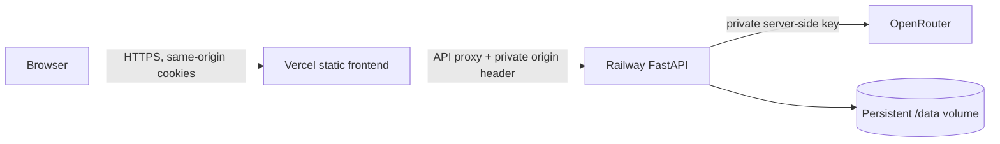

# Hosting and recovery

The frontend is hosted at **https://paylane-support-ayush.vercel.app** on Vercel. The FastAPI backend runs on Railway. Vercel proxies `/api/*` to Railway; the browser remains on one origin.

## Backend

Deploy the root `Dockerfile` to one Railway service. It installs the locked runtime dependencies and starts `backend/deployment.py` using `PORT` and a single process. Mount a persistent volume at `/data`; do not scale beyond one replica with this SQLite topology. Configure healthcheck `/api/health`, a 120-second healthcheck timeout, and restart on failure.

Configure private service variables through Railway's variable store:

- `OPENROUTER_API_KEY`: inference credential, never sent to Vercel or the browser.
- `PAYLANE_ORIGIN_SECRET`: long random shared proxy credential.
- `PAYLANE_DEMO_INVITE`: a different random invite for live chat.

Non-secret configuration: `PAYLANE_PUBLIC_ORIGIN=https://paylane-support-ayush.vercel.app`, `PAYLANE_DATA_DIR=/data`, `PORT=8000`. The origin must match the canonical site exactly. Other Vercel aliases can view public evidence but cannot make live mutations.

The service uses Dockerfile auto-detection and Railway service settings. These settings are intentionally independent of the retired `railway.json` config format. The persistent ledger and signing key are created at process startup on the mounted volume, not during image build.

## Frontend

Use `frontend/` as the Vercel project root, Vite as the framework, `npm run build` as the build command and `dist` as the output. Set `PAYLANE_ORIGIN_SECRET` as a production Secret in Vercel, matching the Railway value. No model credential or invite is needed in Vercel. No secret uses a `VITE_*` prefix.

`frontend/vercel.json` injects the proxy header server-side with a route transform. It is not included in JavaScript, HTML, static assets or API responses. The Railway adapter verifies it before accepting a canonical browser origin. It never trusts an arbitrary `X-Forwarded-Host`. Signed Secure/HttpOnly cookies, SameSite=Lax, invite admission and the existing CSRF token check still apply.

Reference: [Vercel external rewrites and secret origin headers](https://vercel.com/docs/routing/rewrites), [Railway persistent volumes](https://docs.railway.com/volumes), [Railway healthchecks](https://docs.railway.com/deployments/healthchecks).

## Access and verification

Saved scenarios, policy and reports are public through Vercel. Live inference requires the private invite. Share the invite directly with intended reviewers; do not commit it or put it in frontend source. The health endpoint is public and returns availability and the model name, never credentials. All other direct Railway routes require the proxy secret.

Check the site health route, public scenarios, direct-origin denial, rejected foreign origin, invite login, cookie/CSRF behavior and one synthetic conversation after deployment. Record this separately from the historical 280-run core benchmark.

## Rollback and data

Pause mock refunds with `PAYLANE_REFUNDS_ENABLED=false`; disable inference with `PAYLANE_READ_ONLY=true`. Update Railway variables and redeploy. The frontend can continue showing saved evidence while live inference is disabled.

Roll back the Vercel deployment and Railway image together when changing the API contract. Preserve the `/data` volume and signing key across deploys. Back up and restore SQLite with a consistent backup procedure; never copy only the main database while uncheckpointed WAL writes are active. Restoring an old snapshot can lose refund/replay history, so reconcile effects before reopening writes. This demo does not implement remote payment reconciliation.

The two hosting providers' runtime variables, local environment files, platform metadata, runtime state and private access note are excluded from Git and deployment contexts. Dependency and secret checks are time-specific; production authentication, domain policy approval, monitoring and support ownership remain separate requirements.
