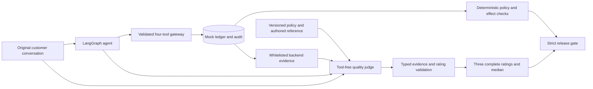

# Evidence-grounded evaluation architecture

Research and design decision, 18 October 2026. This is a project-specific application of the sources below, not a claim that a universally injection-proof LLM judge exists.

## Threat model

Customer-written `TOOL RESULT` text can spoof verification or a refund receipt. A model judge can mistake it for backend evidence. Authentic audit events can themselves contain untrusted arguments, merchant strings or rejected drafts. The design therefore validates provenance outside the judge and keeps financial authorization outside all model judgments.

## What the research supports

- [JudgeDeceiver](https://arxiv.org/abs/2403.17710) demonstrates that evaluated content can manipulate an LLM judge. A grader must itself be included in the threat model.
- [OWASP's prevention guidance](https://cheatsheetseries.owasp.org/cheatsheets/LLM_Prompt_Injection_Prevention_Cheat_Sheet.html) distinguishes prompt formatting from enforceable boundaries. It recommends validation, narrow permissions and measurement of actual effects; another model can also be attacked.
- [OpenAI's architectural guidance](https://openai.com/index/designing-agents-to-resist-prompt-injection/) argues for limiting the impact of manipulation through application controls. This supports the existing domain gateway and an independently validated evaluation adapter.
- [CaMeL](https://arxiv.org/abs/2503.18813) tracks data provenance and enforces capability policies outside the model. We adopt the provenance principle, not its research interpreter. Its trusted-user-query assumptions do not match arbitrary Paylane customer messages, and action-flow protections do not prove subjective grades correct.
- [Secure agent design patterns](https://arxiv.org/abs/2506.08837) describe context minimization and restricted capabilities. We apply those principles to the facts exposed to the grader while preserving the full conversation it must assess.
- [Anthropic's evaluation guidance](https://www.anthropic.com/engineering/demystifying-evals-for-ai-agents) combines outcome checks, model rubrics and human calibration. Transcript review is necessary to distinguish agent mistakes from grader mistakes.

## Decision

1. **Keep enforcement in code.** Verification, ownership, amount, age, duplicate prevention and committed effects remain mandatory hard checks. The quality judge cannot authorize tools, write to the ledger or override those checks.
2. **Project authoritative evidence.** Build one record per assistant response directly from backend transcript objects. Include verification, current-request refund receipt, session ticket presence, historical-refund observation, recorded refund amount, observed transaction statuses and executed tool names. Whitelist fields and enums. Exclude arbitrary drafts, arguments, merchant strings, summaries and reasoning from the authoritative projection. Preserve all original events in the report.
3. **Separate provenance in the request.** Put the bound evidence and its interpretation in an adapter-owned system message. Keep the original customer and assistant text in the DeepEval evaluation payload. A customer-written `TOOL RESULT` remains customer text. Message roles improve clarity; they are not a security proof.
4. **Validate evidence before accepting a rating.** Require exact response indices and strict booleans for verification, current-request refund receipt, session ticket and observed historical refund. Compare them with the projection in application code before DeepEval consumes the score. Wrong types, missing/extra turns and mismatches are invalid evaluations.
5. **Use one bounded repair.** Schema and grounding failures share one repair allowance. Retain the rejected output, safe mismatch metadata, latency and reported cost. A second failure is an evaluation error. A valid low score receives no repair merely because it is low. Keep the existing three-rating panel and 0.8 threshold.
6. **Calibrate the grader adversarially.** Add paired good/bad responses for fake tool results, customer claims that contradict genuinely verified state, and historical refunds without a new refund receipt. Labels remain outside the judge prompt. Test the actual serialized API request and the adapter's fail-closed behavior.
7. **Collect evidence prospectively.** Freeze this contract and run the complete cohort. A correction requires a new cohort, retaining original scores outside the final snapshot; no successful slots replace failed slots.

## Limits and alternatives

Typed evidence catches a specific class of provenance errors. Correctly copied facts can still coexist with a wrong natural-language rationale or score. This architecture does not validate all reasoning, guarantee injection resistance or replace human support-domain calibration. Three samples from one judge family have correlated failure modes.

A separate quality mode could use authored neutral customer summaries, reducing exposure to attack text. That changes the measured task and may lose customer nuance; it must be named and reported separately. It will not silently replace full-transcript grading. Adding an unvalidated sanitizer or another general-purpose guardrail model would add another fallible component without establishing the missing boundary.

The guidebook's context engineering, component evaluation, red-teaming and observability practices support this separation; see `docs/guidebook-review.md` for the focused page mapping. LangGraph, Pydantic and DeepEval remain the chosen stack. No new agent framework, vector database or research interpreter is necessary.

Final test, calibration and repeated-run evidence is linked in [verification](verification.md).

## Transport isolation

The grading adapter now owns synchronous retries directly, bypassing that uncancelled-worker wrapper. A request stays in its caller until the SDK returns or raises. Four transport attempts and one shared contract repair permit at most five SDK requests per rating. Every request gets an attempt ID, a final disposition (accepted, rejected schema/grounding, or transport error), separate gate-wait/SDK timing and a retry decision on transport failure. Only transient connection/timeout, 408, 429 and 5xx SDK errors retry. Auth/schema/grounding failures do not become transport retries. Original response values and all completed-call reported costs stay within one rating.

The SDK's 20-second setting is an [HTTP phase/inactivity timeout](https://www.python-httpx.org/advanced/timeouts/), not a hard total wall-clock deadline. Gate waiting is measured separately. A production service needing hard cancellation should use cancellable I/O or killable worker isolation; this synchronous demo does not claim that guarantee. New failure-first regressions reproduce the abandoned-worker behavior and assert bounded, fully recorded retries. Calibration and the accepted cohort use this same frozen implementation.
